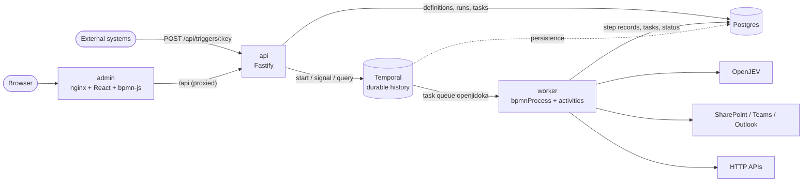
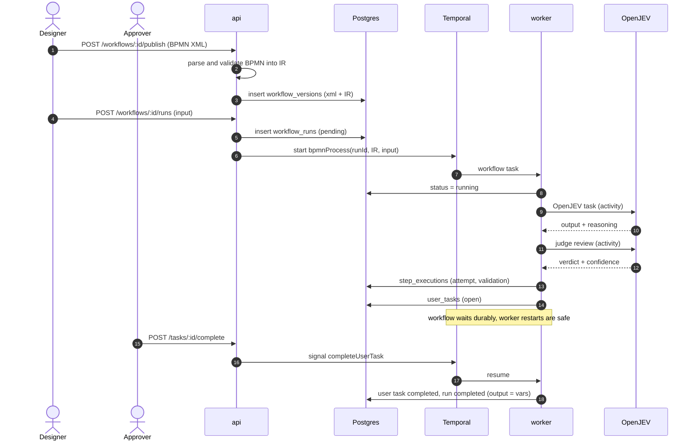
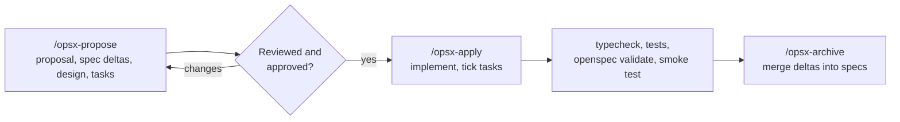
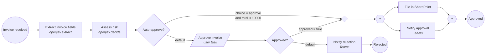
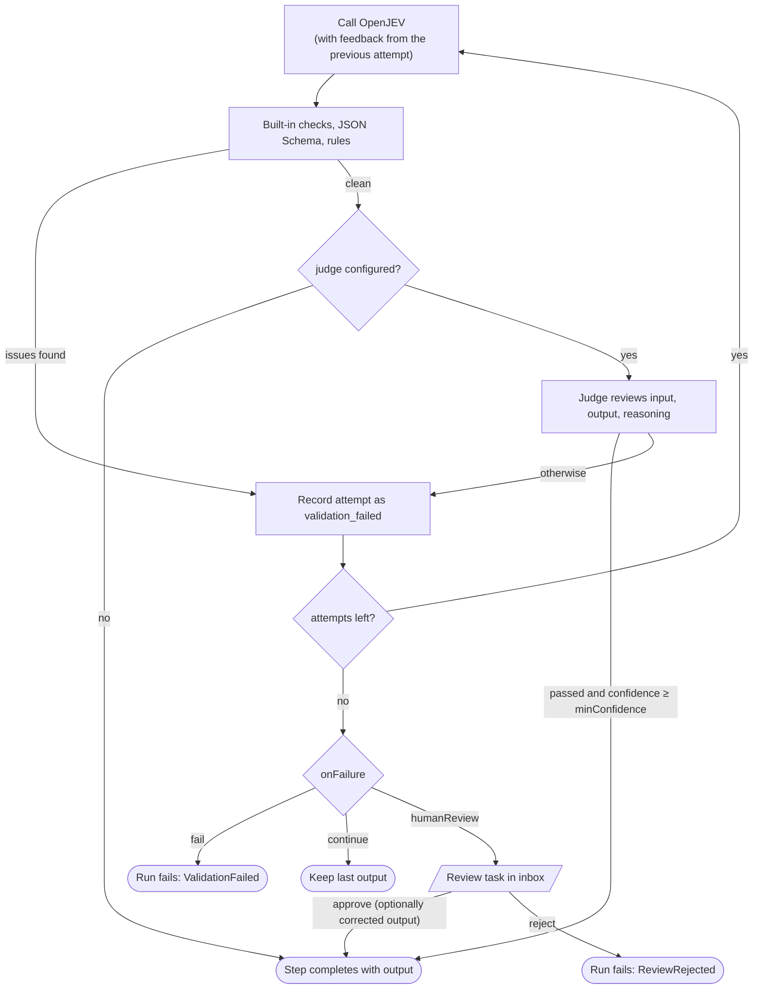
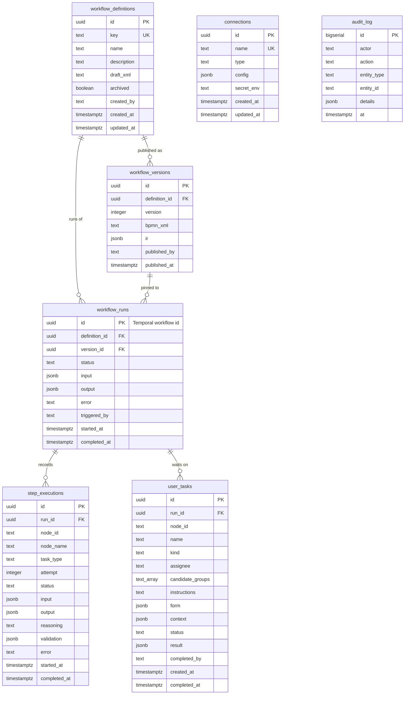

# OpenJidoka — workflow automation harness for OpenJEV

**Version 0.3.1** (2026-11-10). Formerly named JEV Flow.

Documentation diagrams use [Mermaid](https://mermaid.js.org) and render on GitHub, GitLab and most Markdown viewers.
Workflows themselves are BPMN files edited in the admin UI's bpmn-js modeler.

OpenJidoka lets teams draw workflow automations as BPMN diagrams, run them durably on Temporal, and call
OpenJEV for reasoning, decisions and document extraction. Every OpenJEV step can be validated (schema,
business rules, and an independent reviewer model) before its result is trusted, with automatic
retry-with-feedback and escalation to a human reviewer.

---

## Architecture



| Path | What it is |
| --- | --- |
| `packages/core` | Shared types, BPMN → executable graph parser, JSONata expression helpers, `jidoka` BPMN extension |
| `packages/db` | Postgres pool, migration runner, repositories |
| `packages/integrations` | OpenJEV client (HTTP + mock adapters) and connectors (SharePoint, Teams, Outlook, HTTP) |
| `apps/worker` | Temporal worker: generic BPMN interpreter workflow + activities |
| `apps/api` | REST API for the admin UI and external triggers |
| `apps/admin` | Admin UI (React, Tailwind CSS v4 from Tailwind Plus blocks, Headless UI, bpmn-js): BPMN modeler, runs, task inbox, connections, audit log. Shared UI components live in `src/components/ui/` |
| `examples/` | `invoice-approval.bpmn` (seeded), `smoke.bpmn` (used by the smoke test) |

**How a run works.** Publishing parses the BPMN into an immutable graph (IR) stored with the version.
Starting a run passes that IR to one generic Temporal workflow, `bpmnProcess`, which walks the graph
token by token. Because the IR travels with the run, publishing a new version never affects in-flight
runs, and Temporal replays the run after any crash or restart.



## Quick start (Docker)

```bash
cp .env.example .env
# set POSTGRES_PASSWORD (also inside DATABASE_URL) and ADMIN_API_TOKEN, e.g. with: openssl rand -hex 24
docker compose up --build -d
docker compose --profile seed run --rm seed     # example workflow + placeholder connections
./scripts/smoke-test.sh                          # optional end-to-end check
```

- Admin UI: http://localhost:8080 (sign in with `ADMIN_API_TOKEN`; set `ADMIN_PORT` if 8080 is taken)
- API: http://localhost:3000/api
- Temporal UI: http://localhost:8233

With `OPENJEV_MODE=mock` (default) OpenJEV calls return schema-shaped fake data, so everything runs
offline. Set `OPENJEV_MODE=http` plus `OPENJEV_BASE_URL`, `OPENJEV_API_KEY`, `OPENJEV_MODEL` to use the real service.

### Local development (without containers for the apps)

```bash
pnpm install
docker compose up -d postgres temporal temporal-ui
pnpm dev:worker      # in separate terminals
pnpm dev:api
pnpm dev:admin       # http://localhost:5173, proxies /api to :3000
pnpm test && pnpm typecheck
```

Scale workers with `WORKER_REPLICAS=3 docker compose up -d`; they share the Temporal task queue.

### Development workflow (OpenSpec)

All changes go through [OpenSpec](https://github.com/Fission-AI/OpenSpec) (CLI 1.17+, `npm i -g @fission-ai/openspec`).
Requirements live in [`openspec/specs/`](openspec/specs) (one spec per capability), and project constraints for
agents in [`openspec/config.yaml`](openspec/config.yaml).



```bash
openspec list                     # changes in progress
openspec list --specs             # capabilities
openspec show <change>            # read a proposal
openspec validate --all --strict  # check specs and changes
```

| Capability spec | Covers |
| --- | --- |
| `workflow-definitions` | Keys, drafts, supported BPMN, task config, validation, publishing, archiving |
| `workflow-execution` | Runs, version pinning, durability, expressions, routing, timers, failures, status, cancel, step history |
| `ai-tasks` | OpenJEV client, prompt / extract / decide tasks, documents, reasoning capture |
| `ai-validation` | Validation layers, judge, attempts, failure policies |
| `human-tasks` | User and review tasks, completion, inbox |
| `connectors` | Connections and secrets, SharePoint, Teams, Outlook, HTTP |
| `platform-access` | Auth, actor attribution, audit log, triggers, error responses |
| `admin-ui` | Admin screens and behavior |
| `deployment` | Compose stack, admin delivery, migrations, seed, configuration |

---

## Modeling workflows

### Supported BPMN elements

| Element | Behaviour |
| --- | --- |
| Start event (plain) | Run entry point. Runs are started from the API, admin UI or triggers. |
| End event | Ends that token. The run completes when all tokens end. |
| Task / Service / Send / Business rule task | Executes the configured **task type** (below). |
| Script task | `transform` task; JSONata from config `expression` or the script body. |
| User task | Creates a task in the inbox and waits (durably, indefinitely) for completion. |
| Exclusive gateway | First outgoing flow whose condition is true, else the default flow, else the run fails. |
| Parallel gateway | Split: all outgoing flows. Join: waits for every incoming flow. |
| Intermediate timer catch event | Durable sleep for an ISO 8601 duration (`PT15M`, `P1D`, `P1W`). |
| Conditional flows out of tasks | Every flow whose condition is true is followed. |

Anything else (sub-processes, boundary events, message events, inclusive gateways) is rejected at publish time.

The seeded example, [`examples/invoice-approval.bpmn`](examples/invoice-approval.bpmn), looks like this:



Diamonds are exclusive gateways and hexagons are parallel gateways. The empty diamond merges the two
approval paths, because a parallel gateway with two incoming flows would wait for both of them.

### Task configuration

Configuration is stored in the BPMN file as a `jidoka:taskConfig` extension element (namespace
`http://openjidoka.dev/schema/bpmn/1.0`) with attributes `taskType` and `resultVariable` and a JSON body.
The modeler's properties panel edits it and offers a template per task type.

Expressions are [JSONata](https://jsonata.org). In any config string:
- `"=expr"` is replaced by the expression's value (any JSON type),
- `"text {{ expr }} text"` interpolates expressions into a string.

Expressions see `input` (run input), `vars` (named results), `nodes` (result of every node by id) and `run` (`id`, `workflow`).
Each task's result is stored in `nodes.<nodeId>` and, if `resultVariable` is set, in `vars.<resultVariable>`.

| Task type | Required config | Result |
| --- | --- | --- |
| `openjev.prompt` | `prompt`; optional `system`, `outputSchema`, `model`, `temperature` | value matching `outputSchema` (string if none) |
| `openjev.extract` | `document`, `schema`; optional `instructions`, `model` | object matching `schema` |
| `openjev.decide` | `question`, `options` (≥2); optional `context`, `model` | `{ choice, confidence, reasoning }` |
| `connector` | `connection`, `action`; optional `params` | connector action output |
| `transform` | `expression` | expression value |
| user task | optional `assignee`, `candidateGroups`, `instructions`, `form`, `context` | `{ approved, actor, ...formFields }` |

`document` may be `{ "url" }`, `{ "base64", "mimeType", "filename" }`, `{ "text" }` or
`{ "sharepoint": { "connection", "itemId" | "path", "driveId?" } }`. Prefer `sharepoint`/`url` references over
passing file bytes through `input`, which keeps large files out of Temporal history.

`retry` on OpenJEV and connector tasks: `{ maximumAttempts (5), initialInterval ("2s"), backoffCoefficient (2),
maximumInterval ("5 minutes"), startToCloseTimeout ("10 minutes" AI / "2 minutes" connectors) }`. Durations use
Temporal's format (`"5s"`, `"2 minutes"`), not ISO 8601.

### Reasoning validation (OpenJEV tasks)

```json
"validation": {
  "schema": { "...JSON Schema the output must satisfy..." },
  "rules": [{ "expr": "output.total > 0", "message": "Total must be positive" }],
  "judge": { "criteria": "Every value appears in the document.", "minConfidence": 0.8 },
  "maxAttempts": 3,
  "onFailure": "humanReview",
  "reviewAssignee": "ap-team@example.com"
}
```

Each attempt runs these checks:
1. Built-in checks: an output exists; a `decide` choice is one of the options.
2. JSON Schema (`ajv`, with formats).
3. Rules: JSONata over `{ output, reasoning, context }`; falsy means fail with `message`.
4. Judge: an independent OpenJEV call reviews the task input (including the source document for extractions),
   the output and the stated reasoning against `criteria`. It fails on `passed=false` or confidence below `minConfidence` (default 0.7).

Checks 1–3 always all run, so one attempt reports every deterministic issue at once. The judge, which
costs an extra OpenJEV call, only runs when they all pass.



If an attempt fails, its issues are sent back to OpenJEV in the next attempt's prompt. After `maxAttempts`
(default 2 when validation is set), `onFailure` decides: `fail` (default), `continue` (keep the last output),
or `humanReview` (a review task shows the output, reasoning and issues; the reviewer approves, approves with a
corrected `output` JSON, or rejects, which fails the run). Every attempt is recorded with its validation result.

---

## Connectors

Connections store non-secret settings in Postgres. Secrets live only in the worker's environment, and a
connection names the variable in `secretEnv`, which must start with `OPENJIDOKA_SECRET_`.

| Type | Config | Secret | Actions |
| --- | --- | --- | --- |
| `sharepoint` | `tenantId`, `clientId`, `siteId`, `driveId?` | Entra app client secret | `listFiles`, `downloadFile`, `uploadFile`, `createListItem`, `getListItems` |
| `teams` | `channelLabel?` | Teams Workflows webhook URL | `postMessage`, `postAdaptiveCard` |
| `outlook` | `tenantId`, `clientId`, `mailbox` | Entra app client secret | `sendMail` |
| `http` | `baseUrl`, `authHeader?`, `authScheme?`, `headers?` | token / API key | `request` |

SharePoint and Outlook use Microsoft Graph with app-only (client credentials) tokens, cached per app.
Grant the least privilege you can (`Sites.Selected`, `Mail.Send` with an application access policy).
Teams posts go through a Teams Workflows webhook, because Graph does not allow app-only posting to channels.
To add a connector, implement `Connector` in `packages/integrations/src/connectors/` and register it in `index.ts`.

### OpenJEV client

Everything depends on one interface, `OpenJevClient.generate({ system, prompt, schema, attachments, model, temperature })`.
The `http` adapter assumes an OpenAI-compatible `POST {OPENJEV_BASE_URL}/chat/completions` that supports
`response_format: json_schema` and `file` / `image_url` content parts. If OpenJEV's API differs, add an adapter in
`packages/integrations/src/openjev/` and select it in `createOpenJevClient`; nothing else changes.

---

## Business rules

- Workflow keys and connection names: `^[a-z0-9][a-z0-9_-]{1,62}$`; keys are immutable and used by triggers.
- Drafts are freely editable; publishing validates and creates an immutable, incrementing version. Runs start on
  the latest version unless one is specified, and stay pinned to it.
- Diagram layout: BPMN without a diagram gets a generated layout (flow references are derived from the sequence
  flows first, so every flow is drawn). A stored draft or version that has sequence flows but no drawn connections
  is returned with a regenerated layout for display only; published versions are never rewritten, and drafts store
  the fixed layout on their next save. Diagrams with at least one drawn connection are returned as stored.
- Publishing fails (HTTP 422) on parse errors: missing start/end events, tasks without a valid type or required config,
  gateway flows without conditions (except the default), invalid JSON config, invalid JSONata syntax, unsupported elements.
  Warnings (unreachable nodes, AI tasks without validation, gateways that both join and split) do not block publishing.
- Archived workflows cannot start runs.
- A parallel join that can never fire (fewer tokens arrive than incoming flows) fails the run with `StuckParallelJoin`
  instead of completing silently. Merge alternative paths with an exclusive gateway before a parallel split.
- A run fails after 5,000 node executions to stop runaway loops.
- Errors that retrying cannot fix (4xx responses, missing config or secrets, expression runtime errors, validation
  failure) fail the run immediately; network errors, 408/429/5xx and malformed model JSON retry per the task's policy.
- A user task can be completed once; later signals are ignored. Ending a run cancels its open tasks.
- Run status in Postgres is written by the worker; terminal statuses never change. The API reconciles with Temporal
  when a run ended outside the worker (e.g. terminated in the Temporal UI).
- Documents fetched by URL: http(s) only, no redirects, at most `DOCUMENT_MAX_BYTES`, host must match
  `DOCUMENT_URL_ALLOWLIST` when set. HTTP connector paths cannot escape the connection's `baseUrl`.
- Every mutating API call is written to the audit log with the actor.

---

## API

All endpoints except `/api/health` need `Authorization: Bearer <ADMIN_API_TOKEN>`. The optional
`X-OpenJidoka-Actor` header attributes actions in the audit log.

| Method & path | Purpose |
| --- | --- |
| `GET /api/health` | Liveness |
| `GET /api/catalog` | Task types, config templates, connector catalogue (actions + params) |
| `GET /api/workflows?archived=` | List workflows with latest published version |
| `POST /api/workflows` | Create `{ key, name, description?, bpmnXml? }`; generates a layout (with every flow drawn) when the XML has no diagram |
| `GET /api/workflows/:id` | Workflow with draft XML and versions |
| `PUT /api/workflows/:id` | Update `{ name?, description?, draftXml?, archived? }` |
| `POST /api/workflows/:id/validate` | Parse `{ xml? }` (defaults to draft) → `{ valid, errors, warnings }` |
| `POST /api/workflows/:id/publish` | Save `{ xml? }` as draft, validate, create next version |
| `GET /api/workflows/:id/versions/:version` | Published XML (layout regenerated for display if it has no drawn connections) and IR |
| `POST /api/workflows/:id/runs` | Start `{ input, version? }` → `{ id, version }` |
| `POST /api/triggers/:key` | Start the latest version; the JSON body is the run input |
| `GET /api/runs?workflowId=&status=&limit=` | List runs |
| `GET /api/runs/:id` | Run, live state (active/completed nodes, vars), steps, tasks, version XML (layout regenerated for display if it has no drawn connections) |
| `POST /api/runs/:id/cancel` | Cancel a running run |
| `GET /api/tasks?status=open&assignee=` | Task inbox |
| `POST /api/tasks/:id/complete` | Complete `{ approved?, result }` (signals the workflow) |
| `GET/POST /api/connections`, `PUT/DELETE /api/connections/:id` | Manage connections |
| `GET /api/audit?limit=` | Audit log |

Workflow contract (Temporal): workflow type `bpmnProcess`, workflow id = run id, signal `completeUserTask`
`{ taskId, actor, approved?, result }`, query `state`.

---

## Database schema

Postgres, migrated automatically on api/worker start (advisory-locked) or with `pnpm migrate`. Temporal keeps its own
`temporal` and `temporal_visibility` databases on the same server.



`connections` are referenced by name from task config, and `audit_log` by entity type and id, so neither has
foreign keys. Column details follow.

### Migrations

| File | Date | Change |
| --- | --- | --- |
| `001_init.sql` | 2026-11-10 | Initial schema (all tables below) |
| `002_rename_secret_prefix.sql` | 2026-11-10 | Renames stored `JEVFLOW_SECRET_*` references to `OPENJIDOKA_SECRET_*` and replaces the `connections.secret_env` check |

Applied migrations are tracked in `schema_migrations (name text PK, applied_at timestamptz)`.

### `workflow_definitions`
| Column | Type | Notes |
| --- | --- | --- |
| id | uuid PK | `gen_random_uuid()` |
| key | text unique | slug, used by triggers |
| name | text | |
| description | text | default `''` |
| draft_xml | text | editable BPMN |
| archived | boolean | default false |
| created_by | text | actor |
| created_at, updated_at | timestamptz | |

### `workflow_versions`
| Column | Type | Notes |
| --- | --- | --- |
| id | uuid PK | |
| definition_id | uuid FK → workflow_definitions (cascade) | |
| version | integer | unique per definition, increments from 1 |
| bpmn_xml | text | immutable published XML |
| ir | jsonb | executable graph passed to runs |
| published_by | text | |
| published_at | timestamptz | |

### `workflow_runs`
| Column | Type | Notes |
| --- | --- | --- |
| id | uuid PK | also the Temporal workflow id |
| definition_id | uuid FK → workflow_definitions | |
| version_id | uuid FK → workflow_versions | |
| status | text | `pending`, `running`, `completed`, `failed`, `cancelled`, `terminated` |
| input | jsonb | |
| output | jsonb | final `vars` |
| error | text | |
| triggered_by | text | actor or `trigger:<actor>` |
| started_at, completed_at | timestamptz | |

Indexes: `(definition_id, started_at desc)`, `(status, started_at desc)`.

### `step_executions`
| Column | Type | Notes |
| --- | --- | --- |
| id | uuid PK | |
| run_id | uuid FK → workflow_runs (cascade) | |
| node_id, node_name | text | BPMN element |
| task_type | text | task type or node type |
| attempt | integer | OpenJEV attempt number |
| status | text | `completed`, `failed`, `validation_failed`, `waiting` |
| input, output | jsonb | resolved config / result |
| reasoning | text | OpenJEV's stated reasoning |
| validation | jsonb | `{ passed, issues[], confidence?, judgeReasoning? }` |
| error | text | |
| started_at, completed_at | timestamptz | |

Index: `(run_id, started_at)`. Recorded for OpenJEV attempts, connector, transform and user tasks.

### `user_tasks`
| Column | Type | Notes |
| --- | --- | --- |
| id | uuid PK | generated deterministically in the workflow |
| run_id | uuid FK → workflow_runs (cascade) | |
| node_id, name | text | |
| kind | text | `user` (BPMN user task) or `review` (failed AI validation) |
| assignee | text | |
| candidate_groups | text[] | |
| instructions | text | |
| form | jsonb | `[{ name, label?, type: text|number|boolean|json }]` |
| context | jsonb | data shown to the assignee |
| status | text | `open`, `completed`, `cancelled` |
| result | jsonb | |
| completed_by | text | |
| created_at, completed_at | timestamptz | |

Index: `(status, created_at desc)`.

### `connections`
| Column | Type | Notes |
| --- | --- | --- |
| id | uuid PK | |
| name | text unique | referenced from task config |
| type | text | connector type |
| config | jsonb | non-secret settings |
| secret_env | text | env var name, must match `^OPENJIDOKA_SECRET_[A-Z0-9_]+$` |
| created_at, updated_at | timestamptz | |

### `audit_log`
| Column | Type | Notes |
| --- | --- | --- |
| id | bigserial PK | |
| actor | text | |
| action | text | e.g. `workflow.publish`, `run.start`, `task.complete` |
| entity_type, entity_id | text | |
| details | jsonb | |
| at | timestamptz | index `at desc` |

---

## Feature status

| Feature | Status |
| --- | --- |
| BPMN modeler with properties panel, validation markers, publish, start run | ✅ 2026-11-10 |
| Durable execution on Temporal (Postgres persistence), versions pinned per run | ✅ 2026-11-10 |
| Gateways (exclusive, parallel), timers, loops, user tasks | ✅ 2026-11-10 |
| OpenJEV prompt / extract / decide tasks with reasoning capture | ✅ 2026-11-10 |
| Layered reasoning validation, retry with feedback, human review escalation | ✅ 2026-11-10 |
| Connectors: SharePoint, Teams, Outlook, HTTP | ✅ 2026-11-10 (Graph calls not yet exercised against a live tenant) |
| Admin UI: workflows, runs with live diagram state, task inbox, connections, audit | ✅ 2026-11-10 |
| Admin UI refresh: Tailwind CSS v4 / Tailwind Plus, responsive layout with mobile navigation drawer, text status badges, empty states | ✅ 2026-11-10 |
| Generated BPMN layouts draw every flow; stored diagrams without connections display with a regenerated layout | ✅ 2026-11-10 |
| Docker Compose stack, seed, smoke test | ✅ 2026-11-10 |
| SSO (Entra ID OIDC) and roles | ⏳ planned |
| Boundary events / SLAs on user tasks, sub-processes, message events | ⏳ planned |
| Real OpenJEV adapter verified against the actual API | ⏳ needs OpenJEV API details |

## Known issues and constraints

- **Auth is a single shared admin token.** The actor header is self-declared, so the audit log is attribution, not proof.
  Triggers use the same token. Entra ID OIDC with roles (designer, operator, approver) is the next step before production.
- The task inbox does not enforce `assignee` / `candidateGroups`; any authenticated user can complete any task.
- The OpenJEV HTTP adapter assumes an OpenAI-compatible API and has not been run against OpenJEV itself.
- Very long-running or loop-heavy runs will eventually hit Temporal's history limits (~50k events); `continueAsNew` is not implemented yet.
- Large values in `vars` (e.g. base64 files) bloat Temporal history and the 2 MB payload limit applies; pass document references instead.
- Parallel branches share `vars`; if two branches write the same variable, the last write wins.
- User tasks have no due dates or escalation timers yet (needs boundary timer events).
- The compose file uses `temporalio/auto-setup`, which is suited to dev and single-node setups. For production use
  Temporal Cloud or a Helm-deployed cluster, and point `TEMPORAL_ADDRESS` at it.
- The admin bundle is ~950 kB minified / 280 kB gzipped (mostly bpmn-js; Headless UI and Heroicons added ~80 kB);
  code splitting is not set up.
- Dark mode is not supported (the bpmn-js canvas has no matching dark theme).
- `GET /api/workflows?archived=false` returns archived workflows too (the query flag is parsed as a truthy string).
  The admin UI omits the parameter unless archived workflows are requested.
- The modeler is usable on phones only for small edits; the properties panel stacks below the canvas.

## Changelog

- **0.3.1 — 2026-11-10**: Fixed generated BPMN layouts (OpenSpec change `fix-generated-diagram-layout`): BPMN that declares
  flows only via `sourceRef`/`targetRef` was laid out as one column with no arrows. Flow references are now derived
  before layout, and stored diagrams with no drawn connections (including the seeded invoice workflow) are shown
  with a regenerated layout in the editor, version and run views without rewriting published versions.
- **0.3.0 — 2026-11-10**: Admin UI rebuilt with Tailwind CSS v4 from Tailwind Plus Application UI blocks
  (OpenSpec change `refresh-admin-ui-tailwind`): responsive app shell with a navigation drawer below 1024px,
  shared UI components, text status badges, alerts, empty states with next actions, and page headings with
  breadcrumbs. The hand-written stylesheet is replaced by Tailwind plus a small bpmn-js marker block. A fidelity
  pass after review aligned every element with its Tailwind Plus block: bordered status badges, Simple-in-card
  tables that fold secondary columns under the first on narrow screens, one row link plus an ellipsis menu for
  other row actions, table/section/card heading blocks, a details drawer for run steps and audit entries
  (replacing inline JSON and disclosure toggles), and the upload dropzone for BPMN import. No API, data or
  modeler behavior changes.
- **0.2.1 — 2026-11-10**: Adopted OpenSpec for all changes: baseline specs for the nine existing capabilities,
  project constraints in `openspec/config.yaml`, Cursor and generic agent skills, an always-on Cursor rule and
  `AGENTS.md`. No runtime changes.
- **0.2.0 — 2026-11-10**: Renamed the project from JEV Flow to OpenJidoka. Breaking changes:
  packages are `@openjidoka/*`; the BPMN extension prefix is `jidoka:` with namespace
  `http://openjidoka.dev/schema/bpmn/1.0`; connector secrets use `OPENJIDOKA_SECRET_*`; the audit header is
  `X-OpenJidoka-Actor`; the default DB user/name, Temporal task queue and Compose project are `openjidoka`.
  Migration `002` updates stored connection secret names. To upgrade an existing install: rename the
  `JEVFLOW_SECRET_*` variables in `.env`, update `xmlns:jev`/`jev:taskConfig` in saved BPMN to the new
  namespace and prefix, and let in-flight runs on the old `jevflow` task queue finish first.
- **0.1.1 — 2026-11-10**: Documentation diagrams moved to Mermaid: architecture, run lifecycle sequence, the
  invoice example process, the validation flow, and an ER diagram of the schema. Corrected the description of
  validation order (deterministic checks all run; the judge only runs when they pass).
- **0.1.0 — 2026-11-10**: First working version: BPMN parser and interpreter on Temporal, OpenJEV tasks with
  reasoning validation and human review, SharePoint/Teams/Outlook/HTTP connectors, REST API, admin UI with BPMN modeler,
  Docker Compose stack, seed data, unit tests (17) and an end-to-end smoke test.
- **0.0.0 — 2026-11-09**: Project bootstrap.
