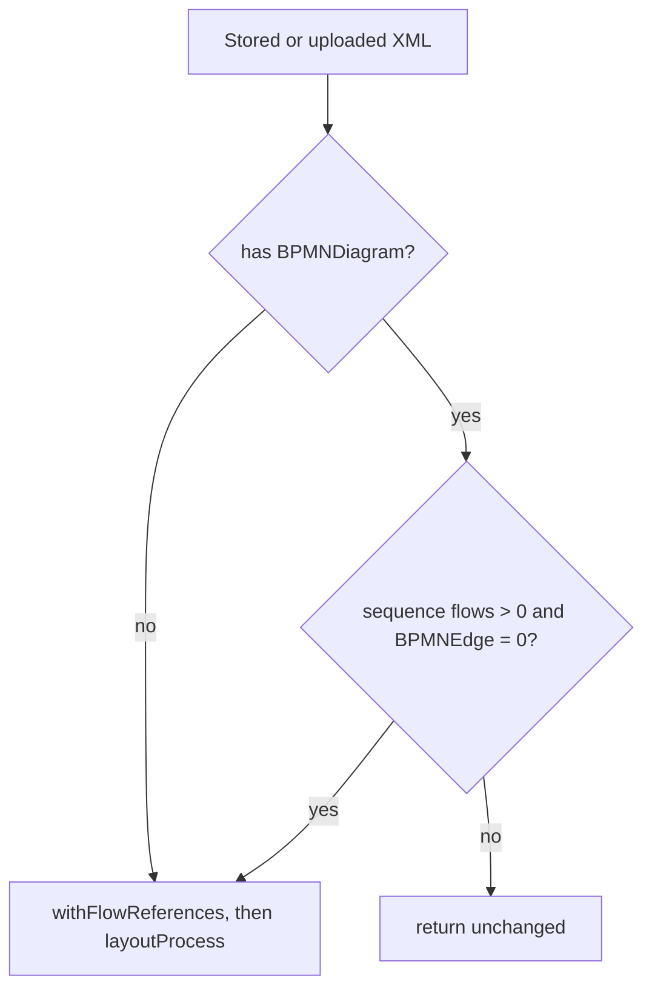

# Design

## Context

`apps/api/src/bpmn-utils.ts#ensureDiagram` calls `bpmn-auto-layout`'s `layoutProcess` when the XML has no
`BPMNDiagram`. `layoutProcess` walks `flowNode.outgoing`, so flows declared only via `sourceRef`/`targetRef` are
invisible to it: verified on `examples/invoice-approval.bpmn`, which produces 14 shapes, 0 edges and 3 distinct x
positions. After filling `incoming`/`outgoing` from the sequence flows it produces 14 shapes, 15 edges, 13 x and 6 y
positions with branches side by side. The seeded invoice workflow's draft and v1, the smoke workflow and any
imports of code-authored BPMN are stored with the broken layout.

## Goals / Non-Goals

**Goals:**
- Correct generated layouts for code-authored BPMN.
- Correct display of already-stored diagrams without touching published versions.

**Non-Goals:**
- Re-laying out partially drawn or hand-arranged diagrams.
- A user-facing "auto-layout" action in the modeler.

## Decisions

**Normalize flow references in `@openjidoka/core/bpmn`.** Add `withFlowReferences(xml)` beside `parseBpmn`: load with
bpmn-moddle (with the `jidoka` extension so task config survives), push each sequence flow onto its source's
`outgoing` and target's `incoming` when missing, and serialize. It lives in core because core already owns
bpmn-moddle and BPMN semantics; the API keeps owning `bpmn-auto-layout`.

**One layout entry point in the API: `layoutForDisplay(xml)`.**

Used on import (`POST /workflows`, seed) and on read (`GET /workflows/:id` draft, `GET /workflows/:id/versions/:version`,
`GET /runs/:id`). Detection counts `bpmn:sequenceFlow` elements and `BPMNEdge` elements; "zero edges" is the only
trigger, so any diagram drawn in the modeler (which always writes edges) is never touched.

Alternatives considered: a one-off migration rewriting stored XML (rejected for published versions: they are
immutable by rule, and display-only repair needs no data change); re-laying out on every read without detection
(rejected: would destroy manual arrangements).

**Drafts heal on save.** The editor already saves the XML it shows, so serving the regenerated draft is enough; no write
on read.

**Cost.** Layout runs only for broken diagrams, which are few and small; no caching for now.

## Risks / Trade-offs

- [Re-layout output differs from the original intended picture] → only applied when nothing was drawn at all.
- [Serializing through bpmn-moddle reorders attributes or drops unknown extensions] → load with the `jidoka` descriptor;
  test that task config, conditions and timers survive and that `parseBpmn` yields the same graph before and after.
- [Run viewer markers rely on element ids] → layout keeps element ids; covered by a test asserting ids are preserved.

## Migration Plan

No data migration. Deploy the API; stored diagrams display correctly immediately; drafts are stored fixed when next
saved. Rollback is redeploying the previous API.
