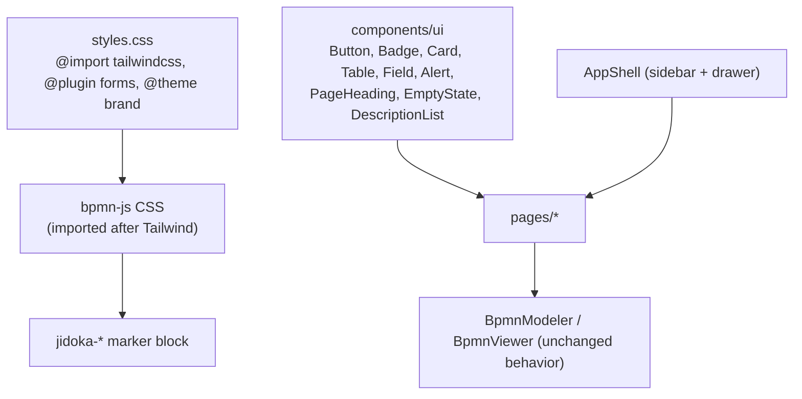

# Design

## Context

The admin app (`apps/admin`) is React 19 + Vite 8 with React Router, styled by one ~350-line `styles.css`. bpmn-js
supplies the modeler and viewer and ships its own CSS (`diagram-js.css`, `bpmn-js.css`, `bpmn-embedded.css`); run and
validation highlighting uses `.djs-element.jidoka-*` marker classes. Requirements are in `specs/admin-ui/spec.md`
(this change) and the main `admin-ui` spec.

## Goals / Non-Goals

**Goals:**
- One set of shared, Tailwind-styled UI components so screens contain layout, not styling decisions.
- Screens visually consistent with Tailwind Plus Application UI, adapted rather than pasted.
- bpmn-js canvas, palette, context pad and markers look and behave exactly as today.

**Non-Goals:**
- Changing data fetching, polling, routing or API contracts.
- Re-theming bpmn-js itself.

## Decisions

**Tailwind v4 via `@tailwindcss/vite`, forms via `@tailwindcss/forms`.** Matches the project's UI standard and needs
no PostCSS config. Alternative (PostCSS plugin) only matters for non-Vite frameworks.

**Tailwind Plus blocks as the source, adapted into `src/components/ui/`.** Blocks are fetched with the tailwind-ui
skill's script (React, v4) and split into small components instead of pasted per screen:

| Screen element | Tailwind Plus block |
| --- | --- |
| App shell + mobile drawer | Application Shells / Sidebar Layouts / Simple dark sidebar |
| Sign-in | Forms / Sign-in and Registration / Simple card |
| Page headers | Headings / Page Headings / With actions and breadcrumbs, With meta and actions |
| Lists (workflows, runs, steps, connections, audit) | Lists / Tables / Simple in card |
| Status badges | Elements / Badges / Flat with dot |
| Errors, notices | Feedback / Alerts / With description |
| Create/edit forms | Forms / Form Layouts / Stacked |
| Empty lists | Feedback / Empty States / With dashed border |
| Run summary, task context | Data Display / Description Lists / Left-aligned in card |
| Task cards, editor side panels | Layout / Cards / Card with header |

Fidelity pass (after review): the first implementation hand-built several pieces and drifted from block classes.
Every element below must come from a block, with the block's classes kept except brand color and dark variants:

| Screen element | Tailwind Plus block |
| --- | --- |
| Status pills in tables and headings | Elements / Badges / With border (replaces Flat with dot) |
| Inline tags (archived, AI review, error/warning) | Lists / Stacked lists / With badges, button, and actions menu (small bordered badge) |
| List pages: header, table, row link | Lists / Tables / Simple in card (its own header, not the large page heading) |
| Narrow screens | Lists / Tables / With stacked columns on mobile (secondary columns fold under the first) |
| More than one row action | Elements / Dropdowns / With minimal menu icon (ellipsis menu) |
| Section titles (Steps) | Headings / Section Headings / With action |
| Card titles | Headings / Card Headings / With description and action |
| Step and audit details | Overlays / Drawers / With close button on outside, content laid out as File details example |
| BPMN import | Forms / Form Layouts / Stacked (file upload dropzone) |
| Actor in sidebar | Elements / Avatars / Circular avatars with placeholder initials |
| Run status filter | Forms / Select Menus / Simple native |

Native `
` disclosures and JSON inside table cells are removed; details open in the drawer instead.

Alternative considered: Catalyst UI kit. Rejected for now: it is a larger dependency surface and the blocks above
cover every screen.

**Headless UI for interactive pieces** (drawer `Dialog`, `Menu` for overflow actions) and **Heroicons** for icons,
because the chosen blocks are written against them.

**One theme token for the brand color** (`@theme { --color-brand-*: ... }` mapped to indigo) so a later rebrand
touches one place.

**bpmn-js isolation.** Import Tailwind first, then the bpmn-js stylesheets, so bpmn-js rules win inside the canvas.
Give canvas containers explicit sizes with utilities. Keep the `jidoka-*` marker rules in a short, labelled block in
`styles.css` (utilities cannot target bpmn-js's generated SVG). Verify that preflight (for example `svg { display:
block }`) does not break the palette, context pad or labels.

**Visual verification by headless screenshots.** Capture each screen at 390px and 1440px with headless Chrome against
the running stack (signed in by seeding the token into local storage from `.env`, never printing it) and review them,
rather than relying on manual browser checks.

## Risks / Trade-offs

- [Preflight resets alter bpmn-js rendering] → import order above; screenshot the editor and run viewer at both widths.
- [Tailwind Plus code under licence ends up somewhere public] → code stays in this private repo; never paste into issues or gists.
- [Bundle grows with Headless UI and Heroicons] → per-icon imports; bundle size noted in Known issues; code-splitting stays a separate change.
- [Behavior regressions while restyling] → keep page components' data logic intact and move only markup; run the smoke test and click through every screen.

## Migration Plan

Admin-only and stateless: rebuild the admin image (`docker compose up -d --build admin`). Rollback is redeploying the
previous image. Stored browser sessions (token and actor in local storage) keep working.
